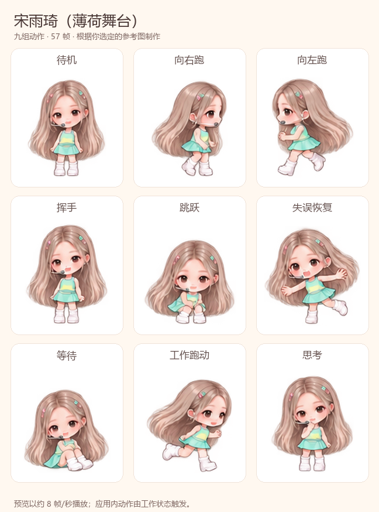

# 宋雨琦 · 薄荷舞台桌面宠物

A fan-made, AI-generated chibi stage companion inspired by Song Yuqi.

浅棕长发、粉色发饰、耳麦和薄荷色舞台服，包含待机、左右跑动、挥手、跳跃、失误恢复、等待、工作跑动和思考九组动画。



[查看动画](assets/preview.gif) · [下载宠物安装包](downloads/song-yuqi-stage.zip) · [查看制作提示词](sources/generation-prompts.txt)

## 安装

下载上面的 ZIP 并解压，将其中整个 `song-yuqi-stage` 文件夹放进自己的 `~/.codex/pets/` 目录。Windows 默认位置为 `%USERPROFILE%\.codex\pets\`。

请随素材保留其中的 `LICENSE.txt`，该文件包含署名、素材许可和配置许可说明。

然后在应用 **设置 → Pets／宠物 → Refresh／刷新** 中选择 **宋雨琦（薄荷舞台）**。若使用了自定义 Codex 主目录，请使用其中的 `pets` 文件夹。

也可以下载整个仓库，在仓库目录运行：

```sh
python tools/install.py
```

安装脚本只使用 Python 标准库。相同文件已经安装时会直接保留；同名目录内容不同时会停止，避免覆盖已有宠物。自定义目录可通过 `--pets-dir` 指定。

官方格式和刷新说明：[Pets 文档](https://learn.chatgpt.com/docs/pets)。

## 动画格式

透明 WebP，1536 × 1872 像素，8 列 × 9 行，每格 192 × 208。

| 行 | 状态 | 帧数 |
| --- | --- | --- |
| 1 | idle／待机 | 6 |
| 2 | run-right／向右跑 | 8 |
| 3 | run-left／向左跑 | 8 |
| 4 | wave／挥手 | 4 |
| 5 | jump／跳跃 | 5 |
| 6 | fail／失误恢复 | 8 |
| 7 | waiting／等待 | 6 |
| 8 | running／工作跑动 | 6 |
| 9 | review／思考 | 6 |

合计 57 帧，另外 15 格完全透明。工作状态中的动画触发和播放速度由应用控制。

## 制作与验证

角色和各动作由内置图像生成工具制作，概念图确认后生成动作图，再修正帧间留白。Python 仅负责定位、统一缩放、排布与编码。

开发检查需要 Python 3.10 或更新版本和 Pillow：

```sh
python -m pip install -r requirements-dev.txt
python tools/validate.py
python tools/build_atlas.py --output build/rebuilt.webp
```

原始动作图、概念图和生成提示词位于 `sources/`。工具不会自动调用付费图像 API。`checksums.sha256` 记录发布素材和安装包的完整性校验值。

已检查保存后的图集尺寸、57 个使用帧、15 个透明格、帧边界、ZIP 内容及安装副本。全部动作帧已逐帧查看。应用内实际载入和工作状态触发尚未实测。

## 来源与许可

这是受舞台造型启发的 AI 粉丝作品，与艺人、其代表机构或 OpenAI 无官方关联或背书。原始参考照片不在仓库中。

Python 代码、宠物配置和原创技术文档采用 [MIT](LICENSE)。角色图像、预览和提示词采用 [CC BY-NC 4.0](ARTWORK-LICENSE.md)，允许署名、非商用共享与改编。请注明 `zhangyuexin-max / song-yuqi-codex-pet contributors`、保留许可链接，并标明修改。该素材许可仅覆盖发布者可授予的权利，不授予明星肖像、商标或官方背书等第三方权利。
